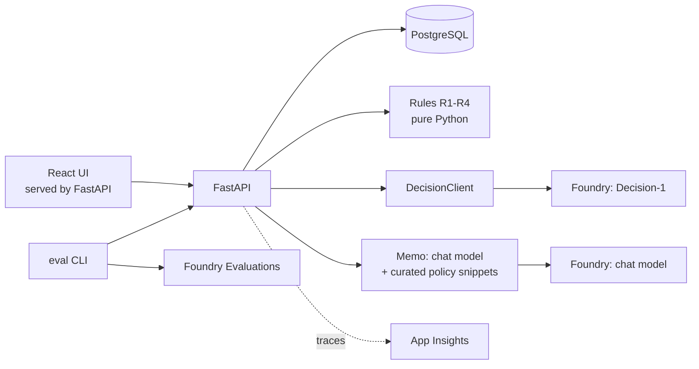

# ClaimLens — Simplified Plan ("Lite"): what to cut, what to keep, why

Companion to `ClaimLens_Product_Blueprint.md`. Where the two disagree, **this file wins**.
Legend: ✅ verified from a source this session · 🧪 my design choice, tune it · ⚠️ check in your own tenant/laptop.

---

## 1. Verdict in six lines

1. **Drop the DE-SynPUF pipeline entirely.** No multi-GB CSVs, no DuckDB, no ICD-9→10 mapping, no 32 GB VM. Generate claims from a small CMS table (13,463 rows) plus the NCCI rule tables.
2. **Develop locally; Azure is only for the models until the end.** The only cloud dependency on Days 1–12 is the Foundry project (Decision-1 + one chat model). Everything else runs on laptops.
3. **Replace RAG with a curated policy table.** The rule set is closed (4 rules), so a lookup by `rule_id` beats vector search. AI Search / Foundry IQ becomes a stretch item.
4. **Real Entra login, Agent Service, MCP, Content Understanding / PDFs: all become time-boxed stretch**, gated on Day 12.
5. **Cut eval size from 1,000 to 300 gold claims**, and cut note-based checks to one slice.
6. **Deploy a walking skeleton on Day 7**, not on Day 19, so Azure policy blockers show up early.

---

## 2. Answer to the 32 GB concern

- The blueprint said DuckDB streams from disk and a 32 GB VM was *optional insurance*. That insurance was over-provisioned advice, and it is **removed**.
- In the Lite plan the largest in-memory object is the NCCI PTP table. We filter it to our code vocabulary (hundreds of codes, not all of Medicare), so the whole data build should fit comfortably on an ordinary 8 GB laptop. ⚠️ Confirm by running it on the weakest laptop in the team on Day 3.
- **No Azure VM is needed.** If Docker is blocked on EY laptops, use the SQLite fallback in §5.

---

## 3. Data: "start from clean data" — what exists and what we do instead

### 3.1 Is there ready-made cleaned data?
- I searched for a pre-cleaned, ready-to-use claims dataset (Hugging Face / CMS) and **did not find one that has the fields our rules need** (units, modifiers, place of service, line-level charges). DE-SynPUF exists on CMS and, as an OMOP version, on AWS, but it lacks those fields, which is why the blueprint needed a long pipeline. I did not find file sizes for DE-SynPUF Sample 1 on its CMS page. ✅
- **But CMS already publishes a small, clean, per-code table that makes DE-SynPUF unnecessary:** *Medicare Physician & Other Practitioners – by Geography and Service*. ✅ Verified through its public API:
  - Filtering to the `National` level returns **13,463 rows** out of 268,350 total. ✅ That is a few small API pages, not a multi-GB download.
  - Each row has: `HCPCS_Cd`, `HCPCS_Desc`, `Place_Of_Srvc` (`O` office / `F` facility), `Tot_Srvcs`, `Tot_Bene_Day_Srvcs`, `Avg_Sbmtd_Chrg`, `Avg_Mdcr_Alowd_Amt`, `Avg_Mdcr_Pymt_Amt`. ✅
  - Public-domain US government work. ✅ (data.cms.gov catalog page)
  - Year: the endpoint I queried is the 2023 release. ✅

  That one table gives us: a real code catalog with descriptions, how often each code is billed, units per day (`Tot_Srvcs ÷ Tot_Bene_Day_Srvcs`), place-of-service mix, and typical billed charge. Those were the fields the old pipeline fabricated in Step C.

### 3.2 Downloads: from 13 datasets to 5

| # | File | How to get it | Size/effort | Used for |
|---|---|---|---|---|
| 1 | **National utilization table** (above) | data.cms.gov API with `filter[Rndrng_Prvdr_Geo_Lvl]=National`, page through with `size`/`offset` | 13,463 rows ✅ | Code catalog, units, POS mix, charge baseline, fee-outlier baseline |
| 2 | **NCCI PTP, practitioner** (4 ZIPs) | CMS NCCI page; accept the AMA license click-through | Largest file; filter to our codes | Rule R1 (code pairs) |
| 3 | **NCCI MUE, practitioner** | CMS NCCI page; accept license | Small | Rule R2 (unit limits) + "is this code still valid" check |
| 4 | **ICD-10-CM code descriptions** | CMS ICD-10 page | Small | Validate the diagnosis codes in our curated list |
| 5 | **NCCI Policy Manual PDF** | CMS NCCI page | One PDF | The PO reads it and copies 15–30 passages (§4, item 6). No chunking pipeline. |

**Dropped:** DE-SynPUF (all files), GEMs / ICD-9, PFS RVU + PFREV26D files, MTSamples, Hugging Face invoice sets, the 'Provider and Service' extract.
Hugging Face is no longer needed for the core build. It stays optional for the PDF stretch only.

⚠️ Inspect the PTP ZIP contents first. If only `.xlsx` is provided, a file of this size is slow in pandas. Try `polars` with the `calamine` engine, convert once to Parquet/CSV, and never re-read the xlsx.

### 3.3 The generator (replaces the whole bronze/silver/gold pipeline)
One script, `datagen/`, fixed random seed, runs in minutes, output is identical on every laptop (compare file hashes). So nobody needs to share data files; everyone runs `make data`.

1. **Build `ref_code`:** from the national table keep `O` and `F` rows; keep codes that also appear in the current MUE table (this drops codes deleted since 2023 — 🧪 sanity-check how many are lost); keep the top ~300 codes by `Tot_Srvcs`. *Why top-N:* common codes keep the claims realistic and keep every later table small.
2. **Load `ref_ptp` filtered** to pairs where both codes are in `ref_code`. *Why both:* the E1 error injector needs a pair we can actually add to a claim.
3. **Load `ref_mue`** for the same codes (value + MAI).
4. **Curated diagnosis map** (`dx_map.csv`): for each code, 2–3 plausible ICD-10-CM codes. The PO and QA review it and validate every code against file #4. *Why hand-curated and not GEMs:* it is ~300 rows, it is the ground truth for error E5, and a human reviewing it is a feature.
5. **Generate CLEAN claims:** 1–4 lines per claim, codes sampled by `Tot_Srvcs` weight; units ≈ `Tot_Srvcs / Tot_Bene_Day_Srvcs` (min 1, capped at the MUE); POS from the `O`/`F` mix; charge ≈ `Avg_Sbmtd_Chrg` with lognormal noise; dx from `dx_map`; synthetic patient and NPI tokens; dates in the first half of Oct 2026. **Reject any generated claim that triggers an active PTP pair or MUE breach**, so "CLEAN" is clean by construction.
6. **Inject labeled errors** (one per claim, as in blueprint Step D, minus E7): E1, E1-NEG, E1-HARD, E2, E3, E4, E5.
7. **E6 (note omits a billed service):** use a chat model to write a short encounter note for ~100 claims (E6 + CLEAN slice only), once, offline. *Why only ~100:* notes are the expensive step and only one check needs them.

### 3.4 Gold test set — 300 claims (was 1,000) 🧪

| Slice | Count |
|---|---|
| CLEAN | 100 |
| E1-NEG (valid modifier, must NOT flag) | 25 |
| E1 | 15 |
| E1-HARD | 10 |
| E2 | 25 |
| E3 | 20 |
| E4 | 20 |
| E5 | 45 |
| E6 | 40 |
| **Total** | **300** |

Dev set: 300 more with a different seed, for tuning. Freeze the gold test on Day 6, record its hash, and never tune on it.

### 3.5 What we lose by doing this (be honest in the demo)
- Claims are statistically plausible per code, **not clinically realistic as visits** (codes are sampled; there is no patient history). Say so.
- **Circularity:** the injector and the rules engine use the same NCCI tables, so rule recall on E1–E3 will be near 100% by construction. That is a *regression test*, not proof the system "discovers" errors. The meaningful numbers are: false-positive rate on CLEAN + E1-NEG, **Decision-1 accuracy and calibration on E5/E6**, and memo faithfulness. Do not put "recall ≥ 0.90 on rules" on the slide as an achievement.
- Costs/units are not from real claim lines. Fine for an MVP; flag it.

---

## 4. Services: keep / stretch / drop

### 4.1 KEEP — the core path

| # | Service / tool | Resolution (simplified use) | Why it stays | Fallback if blocked |
|---|---|---|---|---|
| 1 | **Foundry project (one, shared)** | One resource group, one project for all six. Everyone signs in with `az login`; code uses `DefaultAzureCredential`. No keys in git. | Hub for models, tracing and evals; and it is the Foundry skill we want | Ask admin for a pre-built project |
| 2 | **One chat model deployment** | Use the cheapest model your quota allows. Used for: memo (structured output) and the one-off note generation. | Memo is the generative layer | Any other approved model |
| 3 | **Microsoft-Decision-1** | **2 typed questions only:** `dx_supports_service` (E5) and `note_documents_all_services` (E6). Wrap it behind a `DecisionClient` interface. | The "typed classification" the program wants to see | Same 2 questions via the chat model with enum structured outputs (interface unchanged) |
| 4 | **Tracing → Application Insights** | Turn on once, early (Day 5), when the first model call exists. Trace ID stored per claim. | Observability is a graded theme; setup is small | Log to console/JSON file |
| 5 | **Foundry Evaluations** | Two checks only: (a) groundedness of the memo, (b) our own code evaluator (rule/Decision-1 precision/recall on gold). Run from a CLI script, not a dashboard. ⚠️ Some agent evaluators are still preview — avoid those. | "Evaluation as a feature" | Local scripts, same metrics |
| 6 | **Curated policy table (replaces RAG)** | `policy_snippets(rule_id, text, manual_section, page)` with 15–30 passages the PO copies from the Policy Manual. Memo receives only the snippets for the rule(s) that fired and must cite them. | Closed rule set → exact lookup beats vector search; zero infra; perfect citations | n/a |
| 7 | **PostgreSQL** | Local via Docker for dev; Azure Database for PostgreSQL Flexible Server only for the deployed demo. | Relational data; team knows SQL | **SQLite via SQLAlchemy** (avoid Postgres-only features) |
| 8 | **FastAPI + Pydantic v2** | Synchronous pipeline per claim, run via FastAPI `BackgroundTasks`. | A claim should take seconds | – |
| 9 | **React + TypeScript (Vite)**, built to static files served by FastAPI | 3 screens (§5) | Uses Dev 3's existing strength; one deployable | Minimal server-rendered pages |
| 10 | **Azure Container Apps (one app)** | One container: API + static UI. Deployed as a walking skeleton on Day 7. | Simplest managed way to host a container | App Service for Containers, or a single VM running `docker compose` |

### 4.2 STRETCH — only after the Day 12 gate, in this order

| Order | Item | Time box | Prerequisite |
|---|---|---|---|
| S1 | **MCP rules server** (`FastMCP`, 2 tools) + call it from the memo step | 1 day | Core done |
| S2 | **Foundry Agent Service** wrapper for the memo/triage agent | 1–2 days | S1; project role allows agent creation |
| S3 | **Real Entra sign-in** (Container Apps built-in auth is the lowest-effort route ⚠️ verify) | 1 day | Admin allows app registrations |
| S4 | **CMS-1500 PDFs + Content Understanding** (≈20 clean PDFs, no scan noise) | 2 days | Content Understanding available in region; set its default model to a currently-supported one (GPT-4.1 retires this month per the blueprint research) |
| S5 | **AI Search over the full Policy Manual** | 1–2 days | See free-tier limits below |

If the gate is missed, the stretch list becomes the **roadmap slide**. That is a legitimate outcome.

**AI Search free tier (✅ Microsoft limits page):** 50 MB storage, max 3 indexes, 3 indexers, one free service per subscription, "might be deleted after extended periods of inactivity". The page does not state semantic-ranker or vector-size limits for Free. ⚠️ Vector fields count toward storage, so reduce embedding dimensions or restrict to a few chapters if you try it.

### 4.3 DROP (move to roadmap slide)

| Item | Resolution | Why |
|---|---|---|
| DuckDB, Polars pipeline, 32 GB VM | Removed | No big files anymore |
| Azure Blob Storage | Removed (back only if S4 happens) | Data is generated in-repo; no PDFs |
| Key Vault | Container Apps secrets for the few values we need | One less resource and role assignment |
| Managed identity for Foundry calls | **Use it only if** your role lets you assign roles; otherwise a key in a Container Apps secret, documented as a known compromise | Role assignment is the most common sandbox restriction ⚠️ |
| Content Safety / prompt shields | Roadmap. Keep prompt hygiene: notes are passed as quoted data, never as instructions | Add after core |
| Batch path, copilot chat panel, field-verification screen | Removed | Not needed without PDFs |
| Job queue with `SKIP LOCKED`, `row_version`, hash-chained audit | Plain append-only `audit_events` table (actor, action, time, claim, model/prompt versions) | Four-eyes and audit are preserved; the machinery is not needed at demo scale |
| E7 (E/M over-coding), rule "missing modifier" as its own rule | Folded into E1 / roadmap | Fewer checks, better quality |
| Cosmos DB, Foundry IQ (as core) | Not used | PostgreSQL covers it; IQ is stretch S5 |

---

## 5. Simplified app

**Rules (all deterministic):** R1 PTP pair · R2 MUE units · R3 Duplicate · R4 Fee/charge outlier (soft flag, compares to `Avg_Sbmtd_Chrg`).
**Decision-1 checks:** `dx_supports_service`, `note_documents_all_services`.
**Memo:** structured output, may only cite fired rules + curated snippets.
**Human control:** examiner decides; denial recommendation needs a *different* user (supervisor) to confirm.

**State machine (was 14 states):**
`RECEIVED → PROCESSING → READY_FOR_REVIEW → {APPROVED | RECORDS_REQUESTED | DENIAL_RECOMMENDED → DENIAL_CONFIRMED}`, plus `FAILED`.

**Three screens only:** (1) Queue sorted by risk, (2) Claim detail: lines, findings with rule ID + table version + policy snippet, Decision-1 probabilities, memo, action buttons, (3) Supervisor confirm list. The eval report is a generated Markdown/HTML file from the CLI, not a screen.

**Auth for Days 1–12:** a "dev login" that picks a seeded user (examiner or supervisor) behind an `AuthProvider` interface. The four-eyes rule is enforced in the API and tested. Entra swaps in at S3, or it stays on the roadmap.

**Tables (about 9, was 14):** `ref_code`, `ref_ptp`, `ref_mue`, `policy_snippets`, `claims` (note as a column), `claim_lines`, `findings` (memo JSON as a column), `reviews`, `audit_events`.

**Minimal architecture**


**Python setup (Prerequisites → packages → uv)** — ⚠️ confirm current versions when you lock:
```bash
# Prerequisites: uv, Git, Node LTS, Docker Desktop (or use the SQLite fallback), Azure CLI
uv init claimlens --python 3.14 && cd claimlens
uv add fastapi "uvicorn[standard]" pydantic pydantic-settings sqlalchemy "psycopg[binary]" httpx polars openai azure-identity azure-monitor-opentelemetry azure-ai-evaluation
uv add --dev pytest ruff
```

---

## 6. Azure side — minimum viable setup (Person 6 leads, Dev 1 shadows)

### 6.1 Questions for the program admin on Day 1 (don't assume)
1. Which role do we have on the subscription/resource group (Owner or Contributor)? Can we **create role assignments** and **app registrations**?
2. Allowed regions, and **which models and quota (tokens/min)** we may deploy. Is **Microsoft-Decision-1** visible in the model catalog?
3. Are Container Apps, Container Registry, PostgreSQL Flexible Server, and public network access allowed by Azure Policy?
4. Budget cap or alerts on the sandbox?
5. Is Content Understanding available in our region? (needed only for S4)
6. EY policy: is a private GitHub repo allowed? Are Copilot licences active for all three developers? Can we run Docker on the laptops?

### 6.2 Order of creation (stop and fix on the first failure; do not skip ahead)
1. Resource group (shared).
2. Foundry project.
3. Chat model deployment → test with a 5-line script.
4. Decision-1 deployment → test with one hand-written request (**Dev 1, Day 2–3**). Record the real response shape. The blueprint's field names are a hypothesis until this call works.
5. Application Insights linked to the project.
6. *(Day 7)* Walking skeleton: Container Registry + Container Apps + PostgreSQL Flexible Server with a "hello" endpoint that reads one row.

### 6.3 Decision gate (end of Day 3)
- Chat model works → proceed.
- Decision-1 missing → switch the two questions to chat-model structured outputs behind the same interface and note it in the risk log. The product story stays intact.
- Neither works → fall back to the runner-up use case (CFPB complaint triage) per the research report, which needs only text models.

---

## 7. Team collaboration (six strangers, one repo)

- **One private repo, monorepo:** `datagen/`, `api/`, `rules/`, `ai/`, `web/`, `eval/`, `docs/`.
- **Trunk-based:** short-lived branches, PRs need one approval, squash-merge, CI runs `ruff` + `pytest`.
- **Contracts first (Day 2–3):** freeze the `Claim` / `Finding` / `Memo` Pydantic models and the OpenAPI spec. Then Dev 3 builds the UI against a mock API while Dev 1 and Dev 2 build behind the same models. This removes most integration risk between strangers.
- **Working agreement (one page, signed off Day 1):** 15-minute standup at a fixed time, one task board, "blocked > 4 hours means ask", Definition of Done = merged + tested + demo-able.
- **Copilot:** put project rules into `.github/copilot-instructions.md` (Python 3.14, Pydantic v2, uv, typing, tests). ⚠️ I haven't verified the exact filename support in your Copilot version; check on Day 1.
- **Roles:** Dev 1 = AI + Foundry. Dev 2 = datagen + rules + eval. Dev 3 = API + UI + deploy. Person 4 (PO) = `dx_map.csv`, policy snippets, backlog, demo script. Person 5 (QA/RAI) = gold-set review, test plans, red-team notes. Person 6 (cloud/FinOps) = §6, budget, risk log.

---

## 8. Revised 20-day plan

| Days | Goal | Exit check |
|---|---|---|
| 1–2 | Kickoff, working agreement, repo, admin questions (§6.1), Foundry project, chat model | Everyone can `git push` and run the hello script |
| 2–3 | Decision-1 spike; **freeze contracts** | **Gate A (Day 3):** §6.3 decision |
| 3–6 | Datagen + rules R1–R4 with unit tests; API + DB + UI skeleton on mock data | **Day 6: gold test frozen & hashed**; CLI flags planted errors |
| 5–7 | Tracing on; **walking skeleton deployed** | Hello endpoint on Container Apps reads Postgres |
| 7–10 | Decision-1 integration (2 questions), memo with policy snippets, e2e pipeline | One claim end-to-end with a trace |
| 10–12 | UI complete: queue, detail, approve/records/denial + supervisor confirm; audit log | **Gate B (Day 12):** core demo works on deployed env |
| 13–15 | **Stretch S1 → S2/S3/S4**, whichever fits; otherwise polish and tests | Each stretch demo-able or cut |
| 16–17 | Evaluation run on gold: false positives, Decision-1 P/R + calibration, memo groundedness; tune on **dev** only | `eval/report.md` generated |
| 18 | Hardening, red-team (instruction text inside a note), cost per claim | Bug list closed |
| 19–20 | Freeze, final eval, backup demo video, slides, roadmap | Dry run twice |

---

## 9. Revised acceptance criteria (honest version)

1. 300-claim gold test frozen and hashed; **no tuning on it**.
2. **Rules:** zero false flags on CLEAN and E1-NEG; flags on E1–E4 as a regression test (not a discovery claim).
3. **Decision-1:** precision/recall on E5 and E6 slices, with a calibration plot; compared against the chat-model baseline.
4. **Memo:** every memo cites only fired rules or curated snippets (groundedness evaluator + a code check that cited IDs exist).
5. **Human control:** an automated test shows the API rejects a denial confirmation from the same user who recommended it.
6. Every finding records the rule ID, table version, model and prompt version, and trace ID.
7. Deployed demo runs from the Container App URL with seeded data.

---

## 10. What I am not sure about
- ⚠️ Whether **Decision-1** is visible in your tenant (sources disagree on GA vs preview) and the exact response fields.
- ⚠️ Whether the sandbox allows each resource in §6.1 and role assignments for managed identity.
- ⚠️ The year/vintage mismatch: the utilization table is 2023; rule tables are Oct 2026. The MUE intersect step in §3.3 is how we filter that; check how many codes it removes.
- ⚠️ The PTP file format and size; I have not opened the files.
- 🧪 All counts, top-N, noise, and thresholds are starting points.

**Sources:** [CMS Geography and Service dataset page](https://catalog.data.gov/dataset/medicare-physician-other-practitioners-by-geography-and-service) · [Same dataset, API, national rows](https://data.cms.gov/data-api/v1/dataset/6fea9d79-0129-4e4c-b1b8-23cd86a4f435/data?size=3&filter[Rndrng_Prvdr_Geo_Lvl]=National) · [Azure AI Search limits](https://learn.microsoft.com/en-gb/azure/search/search-limits-quotas-capacity) · [CMS DE-SynPUF Sample 1](https://www.cms.gov/data-research/statistics-trends-and-reports/medicare-claims-synthetic-public-use-files/cms-2008-2010-data-entrepreneurs-synthetic-public-use-file-de-synpuf/de10-sample-1) · [CMS NCCI edits](https://www.cms.gov/medicare/coding-billing/national-correct-coding-initiative-ncci-edits)
